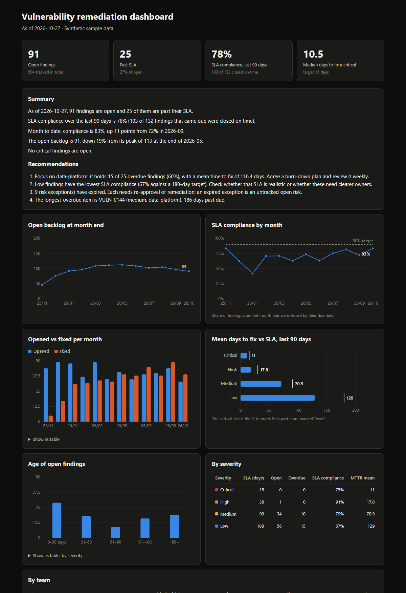

# vuln-sla-dashboard

[](https://github.com/Uppula4070/vuln-sla-dashboard/actions/workflows/ci.yml)

Finding vulnerabilities is half of vulnerability management. The other half is proving they get **fixed on time**. `vulnsla` takes a vulnerability tracker export (CSV from Jira, ServiceNow, or a scanner platform) and produces the metrics a security program reports to leadership:

- **SLA compliance** by severity, by team, and month by month
- **MTTR** (mean and median time to remediate)
- **Backlog trend**: opened vs fixed per month, and open findings at each month end
- **Aging** of open findings, and an **overdue list** with days past due
- **Risk exceptions** that have expired or expire soon
- A **plain-English summary with recommendations**, ready to paste into a monthly report

Output is a single self-contained HTML file (no JavaScript, works offline, light and dark mode) plus optional Markdown and JSON.



**→ Download the [sample dashboard](docs/sample-dashboard.html)** and open it in a browser, or read the [sample monthly summary](docs/sample-summary.md).

## Example output

```
$ vulnsla findings.csv --summary summary.md
As of 2026-10-27, 91 findings are open and 25 of them are past their SLA.
SLA compliance over the last 90 days is 78% (103 of 132 findings that came due were closed on time).
Month to date, compliance is 83%, up 11 points from 72% in 2026-09.
The open backlog is 91, down 19% from its peak of 113 at the end of 2026-05.
No critical findings are open.
```

Recommendations are generated from the data. For example: *"Focus on data-platform: it holds 15 of 25 overdue findings (60%), with a mean time to fix of 116.4 days"*, or *"9 risk exceptions have expired. Each needs re-approval or remediation."*

## How the metrics are defined

Metric definitions decide whether a dashboard tells the truth, so they are explicit:

| Metric | Definition | Why this way |
|---|---|---|
| **SLA due date** | First seen + SLA days for the severity (default critical 15, high 30, medium 90, low 180; change with `--sla`) | Counts from discovery, not from ticket triage, so slow triage can't hide |
| **Overdue** | Still open and older than its SLA | |
| **SLA compliance** | Of findings whose due date fell in the period, the share fixed or formally risk-accepted **by** that date | Open findings past due count as **misses**. A common mistake is measuring only closed tickets, which makes a team that closes nothing look 100% compliant |
| **MTTR** | Days from first seen to fixed, for findings fixed in the window (default 90 days) | Mean **and** median: a few very old fixes drag the mean up |
| **False positives** | Excluded from every metric | They were never real exposure |
| **Expired exception** | A risk-accepted finding whose `exception_expires` date has passed | An expired exception is an open risk nobody is tracking |

## Usage

```bash
pip install git+https://github.com/Uppula4070/vuln-sla-dashboard.git

vulnsla findings.csv -o dashboard.html --summary summary.md --json metrics.json
vulnsla findings.csv --sla critical=7,high=30 --window 30      # your own SLA policy and period
vulnsla findings.csv --fail-if-overdue high                    # CI/automation gate: exit 1 if any high or critical is overdue
```

### Input columns

| Column | Required | Example |
|---|---|---|
| `id` | yes | `VULN-0144` |
| `title` | yes | `TLS 1.0/1.1 enabled` |
| `asset` | yes | `etl-node-07` |
| `owner` | yes | `data-platform` (team responsible for the fix) |
| `severity` | yes | `critical` / `high` / `medium` / `low` |
| `found_date` | yes | `2026-04-24` |
| `status` | yes | `open` / `fixed` / `risk-accepted` / `false-positive` |
| `closed_date` | if fixed or accepted | `2026-05-30` |
| `exception_expires` | for risk-accepted | `2026-08-28` |
| `cve`, `source` | no | `CVE-2023-44487`, `Nessus` |

Bad input is rejected with row numbers, and every problem is listed at once (unknown severity, closed before found, `fixed` without a date, duplicate IDs, and so on). A dashboard built on bad data is worse than none.

## Engineering notes

- **Standard library only.** No pandas and no chart library. Charts are generated inline SVG, so the HTML is one small file you can email or attach to a ticket.
- **Accessible charts.** Every data point has a hover tooltip, every chart has a table view, over-SLA bars are labelled "over" rather than marked by color alone, and dark mode uses its own validated colors.
- **All CSV text is HTML-escaped**, with a test that feeds an `` payload through a finding title.
- **28 tests**, covering each metric definition with small hand-checked datasets, input validation, and the CLI. CI runs them on Python 3.10–3.13 plus ruff with Bandit security rules.
- **Reproducible sample:** CI regenerates the sample data and dashboard and fails if they differ from what is committed.

## About the sample data

`samples/findings.csv` is **synthetic**, generated by [`scripts/make_sample_data.py`](scripts/make_sample_data.py) with a fixed seed: 524 findings across five made-up teams over 12 months. Two patterns are built in so the dashboard has a story to tell: one team remediates much more slowly than the others, and every team speeds up after a CI security pipeline goes live in May. CVE identifiers are real but used only as labels. No employer or customer data is involved.
